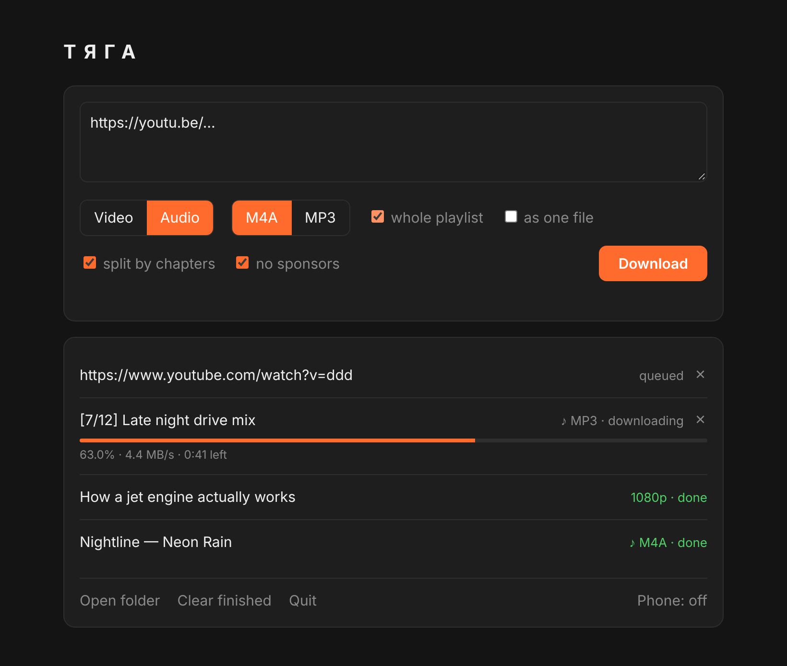

<p align="center">
  
</p>

<h1 align="center">ТЯГА</h1>

<p align="center">
  <b>Paste a YouTube link, get a file.</b><br>
  <a href="../../releases/latest"></a>
  <a href="../../actions/workflows/ci.yml"></a>
  
</p>

*Tyaga* is Ukrainian and Russian for "pull", and that's the whole job: it pulls video and music off YouTube and onto your disk. One small program, nothing to install, and the interface is just a page in your browser. The heavy lifting is done by [yt-dlp](https://github.com/yt-dlp/yt-dlp); TYAGA makes it pleasant.

<p align="center">
  
</p>

## What it can do

**Video.** MP4 at the best quality, or capped at 1080p / 720p / 480p if you'd rather not download a 4K monster. Tick "for editing" and you get H.264 + AAC, which opens in DaVinci Resolve and any player.

**Music.** M4A (the original YouTube track, untouched) or MP3. The tags come out clean: real artist, title without "(Official Video)", year, and a square album cover instead of a 16:9 thumbnail.

**Albums.** A whole album uploaded as one video with chapters? It gets split into proper numbered tracks.

**Playlists and channels.** A playlist goes into its own folder, numbered. A channel link works too, and you get its videos. Or tick "as one file" to glue the whole playlist into one long audio or video, where every video becomes a chapter.

**No sponsors.** SponsorBlock cuts the "this video is sponsored by…" bits and the "don't forget to subscribe". For music it also trims the talking and the movie-scene intros from clips, leaving just the song.

**From your phone.** Paste a link on the phone and the computer downloads it. Then grab the finished file right onto the phone.

Plus the little things: a queue (paste ten links at once), the switches remember how you left them, and endless YouTube Mixes are stopped after the first 25 videos.

Everything lands in `Downloads/YouTube`.

## Run it

1. Grab the archive for your system from [Releases](../../releases/latest).
2. Unpack it anywhere.
3. Run `tyaga`. A page opens. That's it.

On the first run TYAGA fetches what it needs into a `bin` folder next to itself: yt-dlp, ffmpeg and Deno (yt-dlp needs Deno to deal with YouTube). On Windows that's about 250 MB, once. Every download is checked against the checksum its project publishes. yt-dlp updates itself on every start, because YouTube keeps changing things. Already have these tools installed? TYAGA uses yours.

The folder is portable, so carry it on a USB stick if you like.

**Closing it.** On Windows there's no console window, only the page. Hit **Quit** at the bottom, or just close the tab: TYAGA finishes whatever is downloading and leaves on its own. Run it again while it's open, and it simply brings the page back. If something goes wrong, `tyaga.log` next to the program says what happened.

**Windows** may say "Windows protected your PC". Click "More info", then "Run anyway". The program isn't signed, which is normal for small projects.

**macOS** may refuse to open it: `xattr -d com.apple.quarantine tyaga`. ffmpeg comes from Homebrew: `brew install ffmpeg`.

**Linux:** `sudo apt install ffmpeg` (or your distro's version of it).

## From your phone

Click "Phone: off" at the bottom of the page. An address with a short code appears, something like `http://192.168.1.5:8765/?t=k7m2pq`. Open it on a phone on the same Wi-Fi.

The code is new every time, nobody on the network gets in without it, and after 20 wrong guesses the door closes by itself. The first time, Windows asks about the firewall: allow private networks. And the computer has to stay on, since it's the one doing the downloading.

## When YouTube wants you to sign in

Some videos are for signed-in users only, and sometimes YouTube decides you're a bot. Export your YouTube cookies in Netscape format (the "Get cookies.txt LOCALLY" extension does it) and save the file as `youtube-cookies.txt` next to the program.

Cookies are the keys to your account. Don't send them to anyone and don't commit them anywhere (`.gitignore` already keeps them out).

## Under the hood

TYAGA starts a tiny web server that only this computer can reach, with a one-time token in the address, and opens the page. The page hands links to the server, the server runs yt-dlp one link at a time and reports how it's going.

```
main.go      the server and phone access
app.go       life without a console: log, single instance, quitting
jobs.go      the queue and the yt-dlp command
merge.go     gluing a playlist into one file
tools.go     finding and downloading yt-dlp, ffmpeg, Deno
proc_*.go    the bits that differ between Windows and Linux/macOS
index.html   the whole page
```

Only the Go standard library, no third-party packages. The icon and the "Properties → Details" info of the Windows exe live in `winres/` and get baked into `rsrc_windows_*.syso`, which `go build` picks up by itself.

## Build it yourself

You need [Go](https://go.dev/dl/) 1.22 or newer:

```
go build -o tyaga .
```

Tests: `go test ./...` (the merge tests need ffmpeg and skip themselves without it). Every pull request runs them, plus a build for every system.

For Windows without the console window: `GOOS=windows GOARCH=amd64 go build -ldflags -H=windowsgui -o tyaga.exe .`

Flags: `-out folder` sets where files go, `-no-browser` skips opening the page (TYAGA then doesn't quit by itself).

To publish a release with builds for every system: Actions → Release → Run workflow → a version like `v1.2.0`.

## How it started

As `TYAGA.cmd`: a batch file and a TypeScript program in one file, Windows-only and needing Deno installed. Then it grew up and was rewritten in Go, into one program that runs everywhere. The icon says the same thing as the name: a "Т" with speed lines, pulling.

## License

[MIT](LICENSE). yt-dlp, ffmpeg and Deno are separate projects with their own licenses. TYAGA doesn't ship them, it downloads them from their official pages.
